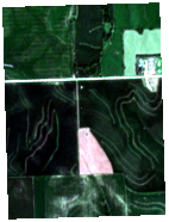
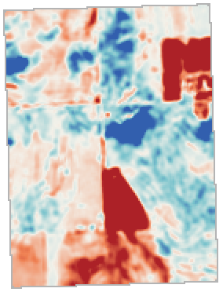
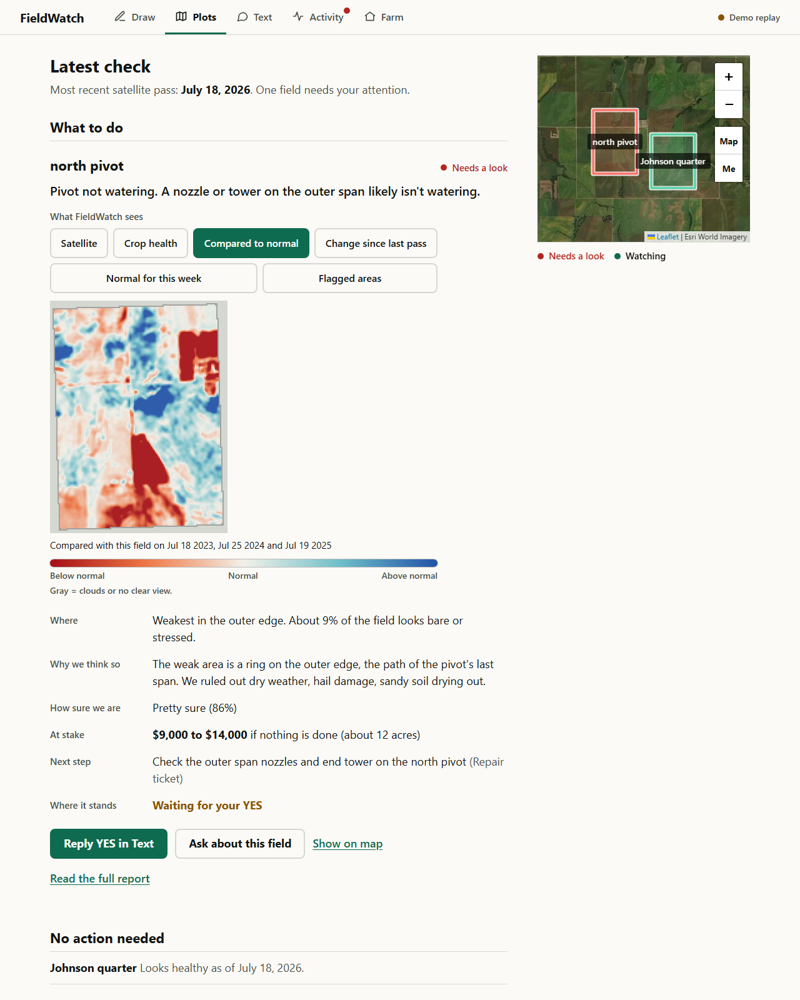
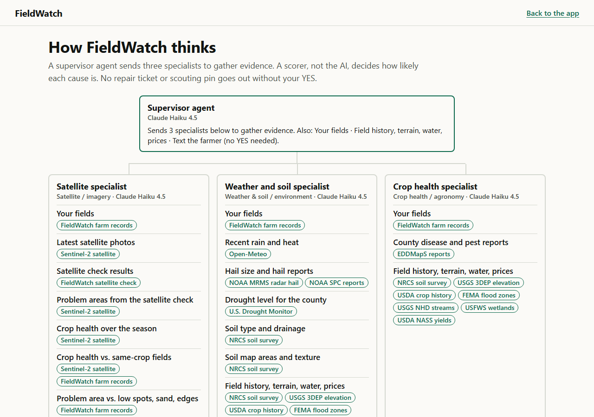
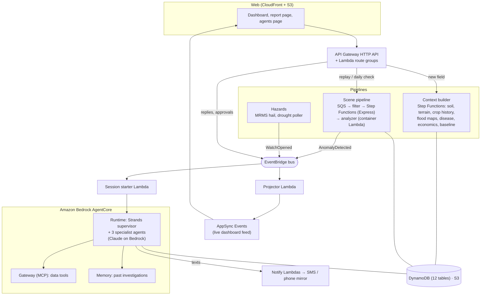

# FieldWatch

**AI agents that watch a farm's fields from space, work out what's wrong, and text the farmer in plain words. Nothing happens on the farm without the farmer's YES.**

Built in about 14 hours at **Hack Midwest 2026** for the AWS challenge ("best use of Strands Agents"), by a three-person team working alongside AI coding agents.

[](https://github.com/FarmU2026/FarmU/actions/workflows/ci.yml)
[](https://github.com/FarmU2026/FarmU/actions/workflows/deploy.yml)

---

## The problem

A broken pivot nozzle, a drowned-out corner, hail, or disease can quietly cost a farm thousands of dollars, and nobody can walk every acre every week. By the time a problem is visible from the road, the yield is gone.

## What FieldWatch does

1. **Watches every field on every satellite pass.** Each new Sentinel-2 scene is compared, pixel by pixel, with **the same field at the same time of year in past seasons**, so a corner that is always a little pale stays quiet, and a corner that suddenly drops gets flagged.
2. **Sends AI agents to investigate.** A supervisor agent sends three specialists (satellite, weather & soil, crop health) to gather evidence from public data: NOAA radar hail, the U.S. Drought Monitor, USDA soil and crop history, FEMA flood maps, county disease reports, and more.
3. **Lets rules, not the model, decide how sure it is.** A deterministic scorer turns the evidence into likelihoods. The text the farmer gets says what's wrong, where, why, how sure, and the dollars at stake.
4. **Waits for a human YES.** Repair tickets and scouting pins are proposed, never sent, until the farmer approves, even if that reply comes hours later.
5. **Answers questions.** The farmer can text "why do you think that?" and get an answer built from the same evidence.

| What the analyzer compares (real Sentinel-2 scene, July 17, 2026) | |
| --- | --- |
|  |  |
| **Satellite (true color)**: a bare patch in a corn field | **Compared to normal**: each spot vs. this field's own past seasons. Red is far below normal, blue above |

| Dashboard (demo mode, bundled sample data) | Who investigates, and the data each tool uses (generated from the code) |
| --- | --- |
|  |  |

## Architecture

Event-driven and serverless on AWS (us-west-2), defined as code in 13 CDK stacks. Nothing runs, or bills much, while idle.



### How the agents work (Strands Agents SDK)

| Strands feature | How FieldWatch uses it |
| --- | --- |
| **Agents as tools** | The supervisor calls `ask_imagery`, `ask_environment` and `ask_agronomy`, each a specialist `Agent`, in parallel |
| **Structured output** | Specialists must return typed evidence items (condition, supports/refutes, weight key, plain reason); the supervisor returns a typed `Diagnosis` |
| **Deterministic tools** | `precheck_evidence`, `score_hypotheses` and `estimate_impact` run rules the model can call but cannot override |
| **MCP tools** | Data tools come from AgentCore Gateway over MCP (SigV4) |
| **Interrupts + sessions** | Write tools call `tool_context.interrupt(...)`; the paused agent is saved with `S3SessionManager` and resumed when the farmer replies, on any Runtime instance |
| **Hooks** | Stream every tool call to the live dashboard, enforce a per-investigation token budget, and overwrite any number in the diagnosis with the scorer's |

Code: [`agent/fieldwatch/agents.py`](agent/fieldwatch/agents.py), [`tools.py`](agent/fieldwatch/tools.py), [`hooks.py`](agent/fieldwatch/hooks.py), [`investigation.py`](agent/fieldwatch/investigation.py), [`toolset.py`](agent/fieldwatch/toolset.py).

### Satellite analysis

Sentinel-2 Level-2A surface reflectance (Element 84 Earth Search, read in place from cloud-optimized GeoTIFFs; only each field's window is read). Per field and date the analyzer ([`agent/fieldwatch/analysis/`](agent/fieldwatch/analysis/)):

- masks clouds and shadow with the scene classification band and drops edge pixels;
- computes NDVI (greenness), NDRE (chlorophyll) and NDMI (moisture);
- builds a per-pixel baseline from the same weeks in the three prior seasons and scores departures (robust z-scores);
- finds regions, describes their shape (pivot ring or wedge, edge band, stripes) and overlap with low spots, sandy soil and hail;
- applies seasonal gates (dry-down, harvest) so end-of-season fields stay quiet;
- writes the overlay images the dashboard shows ("What FieldWatch sees").

Calibration on real scenes is recorded in [`CALIBRATION.md`](agent/fieldwatch/analysis/CALIBRATION.md).

### Data sources

| Source | Used for |
| --- | --- |
| Sentinel-2 L2A (ESA, via Element 84 Earth Search) | Crop health, baselines, change, overlays |
| Open-Meteo archive | Rain and temperature vs. normal |
| NOAA MRMS radar hail + SPC storm reports | Hail size and hail watches |
| U.S. Drought Monitor | County drought level |
| USDA NRCS Soil Data Access (SSURGO) | Soil texture and drainage |
| USGS 3DEP | Terrain low spots |
| USDA Crop Sequence Boundaries | Crop history, same-crop neighbors |
| FEMA NFHL, USGS NHD, USFWS NWI | Flood zones, streams, wetlands |
| EDDMapS | County disease reports (tar spot, southern rust, gray leaf spot) |
| USDA NASS Quick Stats | County yields and prices for dollar estimates |

## Engineering practices

- **Infrastructure as code:** 13 AWS CDK (Python) stacks; the agent deploys with the AgentCore CLI.
- **CI/CD:** GitHub Actions runs tests, `cdk synth` and secret scanning on every PR, and deploys `main` through OIDC (no stored AWS keys). A small merge bot re-tests green PRs on top of the latest `main` before merging.
- **Contracts first:** shared Pydantic contracts ([`contracts.py`](agent/fieldwatch/contracts.py)) and a single cross-workstream interface module ([`interfaces.py`](agent/fieldwatch/interfaces.py)) let three people and several AI agents build in parallel; CI enforces the boundaries.
- **Safety by design:** the model never sets confidence numbers; write actions need a recorded human approval; read-only agents answer chat; farmer text is always treated as data, never instructions.
- **Least privilege:** per-function IAM, a permissions boundary on every role, and secrets in SSM Parameter Store.
- **Operations:** CloudWatch alarms and a dashboard, traces through AgentCore Observability, API throttling, Lambda concurrency caps, a token budget per investigation, and a budget alert.
- **Tests:** about 960 automated tests (`pytest`, `moto`), plus live-marked checks against real public data.

## Repository layout

| Path | What |
| --- | --- |
| [`agent/fieldwatch/`](agent/fieldwatch/) | Agents, tools, scorer, analyzer, context functions, contracts |
| [`agent/cloud/`](agent/cloud/) | Lambda handlers (API, scenes, context, hazards, notify, feed), Gateway, AgentCore project |
| [`agent/catalog/`](agent/catalog/) | Condition catalog and loss tables the scorer uses (weights are drafts pending agronomy review) |
| [`agent/eval/`](agent/eval/) | Scenario runner for end-to-end evaluations |
| [`agent/tests/`](agent/tests/) | Test suite |
| [`infra/`](infra/) | CDK app and stacks |
| [`web/`](web/) | Static front end (dashboard, report, work order, agents page) |
| [`docs/`](docs/) | The original plan, build decisions and spike findings ([index](docs/README.md)) |

## Running it

```bash
cd agent
python -m pip install -r requirements-dev.txt
python -m pytest tests -q -m "not live"        # no AWS needed

# local dev harness (sample farm, no AWS)
python -m uvicorn web.server:app --port 8000
```

The UI also has a no-backend demo mode: serve `web/` (`python web/dev-serve.py`) and open `index.html?demo=1`.

Deploying needs an AWS account; see [`infra/README.md`](infra/README.md) and [`agent/cloud/agentcore/README.md`](agent/cloud/agentcore/README.md).

## Status and limitations

This is a hackathon build, not a production service.

- Diagnoses on ambiguous cases are not yet stable from run to run, and the scorer's weights are drafts pending agronomist review.
- Detection has been calibrated on a small set of real fields; a broader validation (for example, a backtest against radar-mapped hail) was planned but not finished.
- Standing water in bare spring fields is not detected (that needs Sentinel-1 radar, which is not integrated).
- Real SMS requires Twilio carrier registration; the dashboard's phone mirror shows the same messages.
- Photo uploads from the farmer are not wired into the investigation yet.

## Team

- **Caleb Kelly** ([@Caleb-Kelly-25](https://github.com/Caleb-Kelly-25)): architecture, AWS infrastructure and CI/CD, agent runtime and integration
- **Aaron Wohleb** ([@aaronwohleb](https://github.com/aaronwohleb)): field analyzer, scorer and condition catalog, agent reasoning, front-end redesign
- **Kurt** ([@kdumbl](https://github.com/kdumbl)): notifications, hazard pipelines, field context data

Much of the code was written with AI coding agents (Claude Code) working in parallel workstreams; [`CLAUDE.md`](CLAUDE.md) and [`docs/workstreams.md`](docs/workstreams.md) show how the work was split and coordinated.
